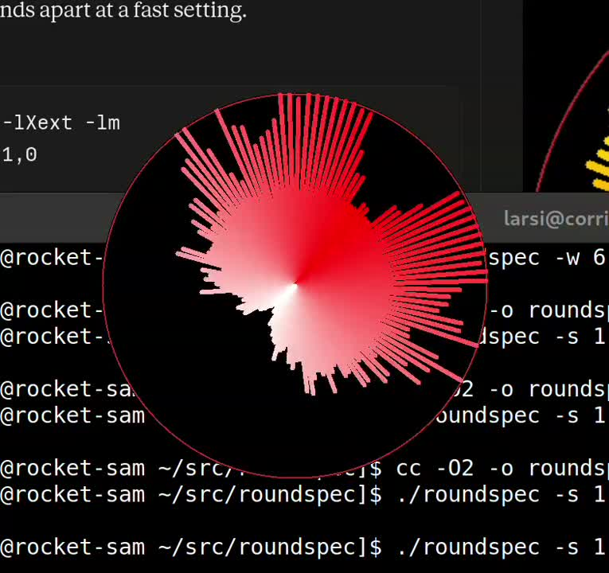

Real-time FFT display for ALSA and X.  Written by Fable 5.2.

How to use:

sudo modprobe snd-aloop
make
./roundspec plughw:Loopback,1,0

Something like the example asound.conf file should be put in
/etc/asound.conf.

